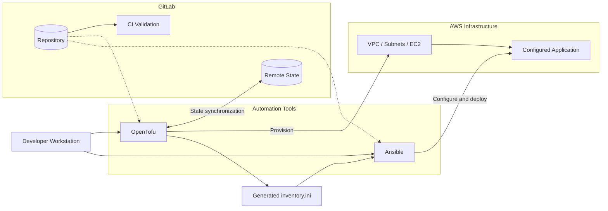
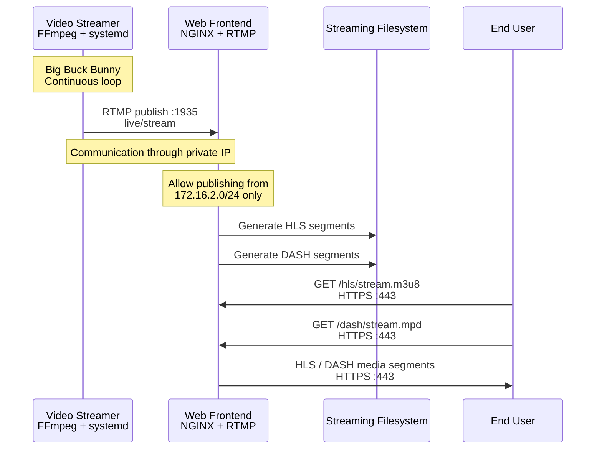
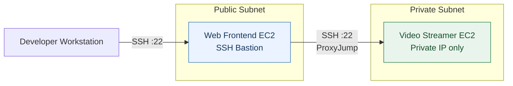
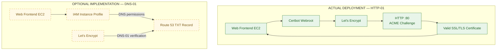

# GIN207 — AWS Video Streaming Architecture

This document describes the actual architecture implemented for the GIN207 AWS Video Streaming project. It is based on the OpenTofu infrastructure configuration, Ansible roles, deployment playbooks, and the resources deployed in AWS.

It covers the automation layer, AWS network topology, application components, streaming workflow, security configuration, and certificate management.

**Important:** This document distinguishes between features actually deployed and features implemented in code but unavailable in the DevopsLab environment.


# 1\. Architecture Overview

The project implements a two-tier video streaming architecture on AWS. Infrastructure provisioning is automated using OpenTofu, while Ansible manages server configuration and application deployment.

The architecture separates the public-facing Web Frontend from the private Video Streamer. The Web Frontend receives RTMP streams, generates HLS and DASH content, and serves video playback over HTTPS. The Video Streamer continuously transmits video through the private AWS network.

The infrastructure also includes a NAT Gateway, an SSH bastion mechanism, automated inventory generation, GitLab remote state, and a CI validation pipeline.

## 1.1 Complete Architecture Diagram

The following diagram provides an overview of the infrastructure, including the automation layer, AWS networking, EC2 instances, security components, and external services.

mermaid

```mermaid
%%{init: {"theme":"base","themeVariables":{"fontFamily":"Arial","primaryTextColor":"#232F3E","lineColor":"#64748b","clusterBkg":"#F8FAFC","clusterBorder":"#94A3B8"}}}%%
flowchart TB

    subgraph EXT["EXTERNAL SERVICES"]
        direction LR
        USERS(["End Users"])
        TEAM(["Development Team"])
        LE["Let's Encrypt"]
        BLENDER["download.blender.org"]
    end

    subgraph AUTOMATION["AUTOMATION & INFRASTRUCTURE MANAGEMENT"]
        direction LR

        subgraph LOCAL["Developer Workstation"]
            TOFU["OpenTofu<br/>Infrastructure provisioning"]
            ANS["Ansible<br/>Configuration & deployment"]
        end

        subgraph GITLAB["GitLab"]
            REPO[("GIN207 Repository")]
            STATE[("Remote State<br/>HTTP Backend")]
            CI["CI Pipeline<br/>Tofu validation<br/>Ansible syntax check"]
        end

        INV["Generated Ansible Inventory<br/>inventory.ini"]

        TOFU <-->|"State"| STATE
        REPO --> CI
        TOFU --> INV
        INV --> ANS
        REPO -.-> TOFU
        REPO -.-> ANS
    end

    subgraph AWS["AWS CLOUD — us-east-1"]

        R53[("Amazon Route 53<br/>DNS A Record<br/>TTL 300")]

        subgraph VPC["VPC — 172.16.0.0/16"]

            IGW{{"Internet Gateway"}}

            subgraph PUBLIC["PUBLIC SUBNET — 172.16.1.0/24"]

                direction TB

                EIP["Elastic IP<br/>x-projectBKN-web-eip"]

                subgraph WEB["EC2 — x-projectBKN-web-frontend<br/>Ubuntu 22.04 · t2.micro"]
                    NGINX["NGINX<br/>RTMP Module"]
                    HLS["HLS Output<br/>stream.m3u8"]
                    DASH["DASH Output<br/>stream.mpd"]
                    WEB_SG["Web Security Group<br/>HTTPS :443 — World<br/>HTTP :80 — World<br/>SSH :22 — Team CIDR<br/>RTMP :1935 — Streamer SG"]
                    NGINX --> HLS
                    NGINX --> DASH
                end

                NAT[("NAT Gateway<br/>+ NAT Elastic IP")]
                PUBRT["Public Route Table<br/>0.0.0.0/0 → IGW"]

            end

            subgraph PRIVATE["PRIVATE SUBNET — 172.16.2.0/24"]

                direction TB

                subgraph STREAM["EC2 — x-projectBKN-video-streamer<br/>Ubuntu 22.04 · t2.micro<br/>No Public IP"]
                    FFMPEG["FFmpeg"]
                    SYSTEMD["systemd<br/>ffmpeg-stream.service<br/>Restart=always"]
                    VIDEO[("Big Buck Bunny<br/>MP4 Sample Video")]
                    STREAM_SG["Streamer Security Group<br/>SSH :22 — Web subnet<br/>RTMP egress :1935 → Web<br/>Outbound → 0.0.0.0/0"]
                    VIDEO --> FFMPEG
                    SYSTEMD --> FFMPEG
                end

                PRIVRT["Private Route Table<br/>0.0.0.0/0 → NAT"]

            end

            IAM["IAM Role / Instance Profile<br/>DNS-01 — Optional<br/>Not deployed in DevopsLab"]

        end
    end

    USERS -->|"HTTPS :443"| EIP
    USERS -.->|"HTTP :80<br/>Redirect / ACME challenge"| EIP
    EIP  WEB

    TEAM -->|"SSH :22"| WEB
    WEB -.->|"SSH ProxyJump :22"| STREAM

    R53 -.->|"DNS resolution"| EIP

    FFMPEG ==>|"RTMP :1935<br/>Private Web IP"| NGINX

    HLS -->|"HTTPS playback"| USERS
    DASH -->|"HTTPS playback"| USERS

    PUBRT --> IGW
    PRIVRT --> NAT
    NAT --> IGW

    STREAM -->|"Outbound traffic<br/>apt / get_url"| NAT
    NAT --> BLENDER

    WEB <-->|"HTTP-01 validation<br/>Production"| LE
    IAM -.->|"DNS permissions<br/>Optional DNS-01"| R53
    LE -.->|"DNS-01 TXT challenge<br/>Not deployed"| R53

    TOFU -->|"Provision AWS resources"| VPC
    ANS -->|"Configure Web EC2"| WEB
    ANS -->|"Configure Streamer EC2<br/>via bastion"| STREAM

    classDef aws fill:#FFF3E0,stroke:#FF9900,stroke-width:2px,color:#232F3E
    classDef ec2 fill:#EAF3FF,stroke:#3978B8,stroke-width:2px,color:#17365D
    classDef network fill:#E8F4FA,stroke:#2585A8,stroke-width:2px,color:#16445B
    classDef private fill:#E9F5EC,stroke:#27834A,stroke-width:2px,color:#164D2C
    classDef automation fill:#F1EDFF,stroke:#7956B8,stroke-width:2px,color:#392568
    classDef external fill:#F8FAFC,stroke:#64748B,stroke-width:1px,color:#334155
    classDef optional fill:#FFF9E6,stroke:#D69E24,stroke-width:2px,stroke-dasharray:5 5,color:#775512

    class R53,IGW,NAT,EIP aws
    class WEB,NGINX,HLS,DASH ec2
    class STREAM,FFMPEG,SYSTEMD,VIDEO private
    class WEB_SG,STREAM_SG,PUBRT,PRIVRT network
    class TOFU,ANS,REPO,STATE,CI,INV automation
    class USERS,TEAM,LE,BLENDER external
    class IAM optional
```

## 1.2 Main Components

| Component | Responsibility |
|  |  |
| OpenTofu | Provisions AWS infrastructure |
| Ansible | Configures EC2 instances and deploys application services |
| GitLab | Hosts the repository, remote state, and CI pipeline |
| AWS VPC | Provides an isolated virtual network |
| Public Subnet | Hosts the Web Frontend and NAT Gateway |
| Private Subnet | Hosts the Video Streamer |
| Internet Gateway | Provides internet connectivity to the VPC |
| NAT Gateway | Allows outbound internet access from the private subnet |
| Route 53 | Manages the application's DNS record |
| EC2 Web Frontend | Receives RTMP streams and serves HLS/DASH content |
| EC2 Video Streamer | Continuously sends video through FFmpeg |
| Security Groups | Restrict network access |
| Let's Encrypt | Issues SSL/TLS certificates |


# 2\. Automation and Infrastructure Management

Infrastructure provisioning and application configuration are separated into two automation stages.

## 2.1 OpenTofu — Infrastructure Provisioning

OpenTofu is used to create and manage AWS resources through infrastructure-as-code configuration.

The main resources include:

- VPC and subnets.
- Internet Gateway and NAT Gateway.
- Public and private route tables.
- EC2 instances.
- Elastic IP addresses.
- Security groups and rules.
- Route 53 DNS records.
- Optional IAM role and instance profile for DNS-01.
- Automatically generated Ansible inventory.

The infrastructure state is stored remotely in GitLab, allowing team members to share the same infrastructure state.

## 2.2 Ansible — Configuration Management

Ansible configures the EC2 instances after infrastructure provisioning.

The deployment is centralized through:

`ansible/playbooks/deploy-all.yml`

The execution order is:

text

```text
web-setup
    ↓
deploy-certificate
    ↓
deploy-website
    ↓
streamer-setup
    ↓
validate-streaming
```

The Ansible inventory is generated automatically by OpenTofu in:

`ansible/inventory.ini`

This avoids manually copying IP addresses, domain names, and network configuration between Terraform and Ansible.

## 2.3 GitLab CI

The GitLab CI pipeline performs automated validation when changes are pushed to the repository.

The current pipeline includes:

- `tofu validate`.
- Ansible syntax checks.

The CI pipeline does not currently perform automatic infrastructure provisioning or application deployment.

## 2.4 Automation Workflow

mermaid




# 3\. AWS Network Topology

The infrastructure is deployed inside a dedicated AWS VPC.

The VPC uses the CIDR block:

`172.16.0.0/16`

It is divided into two subnets with different network access characteristics.

## 3.1 Public Subnet

**CIDR:** `172.16.1.0/24`

The public subnet hosts:

- Web Frontend EC2 instance.
- Elastic IP assigned to the Web Frontend.
- NAT Gateway.
- Public route table.

The Web Frontend is the only application server directly exposed to the internet.

Its security group allows:

| Port | Protocol | Source | Purpose |
|  |  |  |  |
| 22 | SSH | `admin_ssh_cidr_blocks` | Team administration |
| 80 | HTTP | `0.0.0.0/0` | HTTPS redirection and ACME HTTP-01 |
| 443 | HTTPS | `0.0.0.0/0` | User video access |
| 1935 | RTMP | Streamer security group | Video ingestion |

The Web Frontend also acts as an SSH bastion for the private Video Streamer.

## 3.2 Private Subnet

**CIDR:** `172.16.2.0/24`

The private subnet hosts the Video Streamer EC2 instance.

It does not have a public IP address.

Its security group includes:

| Port | Protocol | Source / Destination | Purpose |
|  |  |  |  |
| 22 | SSH | Web subnet `172.16.1.0/24` | Administration through bastion |
| 1935 | RTMP | Web security group | Outbound video publishing |
| All | Outbound | `0.0.0.0/0` | Package installation and downloads |

The private instance cannot be directly accessed by end users from the public internet.

## 3.3 Internet Gateway and NAT Gateway

The architecture uses two different gateways.

**Internet Gateway (IGW)**

Provides internet connectivity for resources in the public subnet through the public route table.

**NAT Gateway**

Allows resources in the private subnet to initiate outbound connections without requiring public IP addresses.

The Video Streamer uses the NAT Gateway for:

- Ubuntu package installation through `apt`.
- Downloading the Big Buck Bunny sample video.
- Other required outbound connections.

## 3.4 Routing Configuration

| Route Table | Destination | Target |
|  |  |  |
| Public Route Table | `0.0.0.0/0` | Internet Gateway |
| Private Route Table | `0.0.0.0/0` | NAT Gateway |

The private subnet does not have a direct route to the Internet Gateway.

## 3.5 Network Topology Diagram

mermaid

```mermaid
flowchart TB

    USERS(["End Users"])
    TEAM(["Development Team"])
    INTERNET["Internet"]

    subgraph AWS["AWS Cloud — us-east-1"]
        R53["Route 53<br/>A Record → Web EIP"]

        subgraph VPC["VPC 172.16.0.0/16"]

            IGW{{"Internet Gateway"}}

            subgraph PUBLIC["Public Subnet — 172.16.1.0/24"]
                EIP["Web Elastic IP"]
                WEB["Web EC2<br/>NGINX / RTMP"]
                NAT["NAT Gateway"]
                PUBRT["Public Route Table<br/>0.0.0.0/0 → IGW"]
            end

            subgraph PRIVATE["Private Subnet — 172.16.2.0/24"]
                STREAM["Streamer EC2<br/>FFmpeg<br/>No Public IP"]
                PRIVRT["Private Route Table<br/>0.0.0.0/0 → NAT"]
            end
        end
    end

    USERS -->|"HTTPS :443"| EIP
    TEAM -->|"SSH :22"| WEB
    WEB -.->|"ProxyJump SSH :22"| STREAM

    EIP  WEB
    R53 -.-> EIP

    STREAM -->|"RTMP :1935<br/>Private IP"| WEB

    PUBRT --> IGW
    PRIVRT --> NAT
    NAT --> IGW

    IGW --> INTERNET
```


# 4\. Application Architecture and Streaming Workflow

The application consists of two main EC2 instances with separate responsibilities.

## 4.1 Web Frontend

The Web Frontend runs on the public EC2 instance.

Installed software:

- NGINX.
- `libnginx-mod-rtmp`.
- FFmpeg.
- Certbot.
- Certbot Route 53 plugin (available for the optional DNS-01 configuration).

The Web Frontend performs three main tasks:

1. Receives RTMP video streams from the private Video Streamer.
2. Generates HLS and DASH video segments.
3. Serves the resulting content to users through HTTPS.

The streaming directories are:

text

```text
/var/www/html/stream/
├── hls/
└── dash/
```

The application exposes the following endpoints:

| Service | Endpoint |
|  |  |
| HLS | `/hls/stream.m3u8` |
| DASH | `/dash/stream.mpd` |

## 4.2 Video Streamer

The Video Streamer runs on the private EC2 instance.

Its main software component is FFmpeg.

The sample video used is:

`BigBuckBunny_320x180.mp4`

It is downloaded from:

`download.blender.org`

FFmpeg continuously sends the video to the Web Frontend through RTMP.

The process is managed by a systemd service:

`ffmpeg-stream.service`

The service provides:

- Automatic startup.
- Automatic restart through `Restart=always`.
- Execution under a dedicated system user named `streamer`.
- Continuous video transmission.

## 4.3 RTMP Streaming Configuration

The FFmpeg service executes a command equivalent to:

bash

```bash
ffmpeg -stream_loop -1 -re \
  -i /videos/BigBuckBunny_320x180.mp4 \
  -c:v libx264 \
  -c:a aac \
  -f flv \
  rtmp://<web-private-ip>:1935/live/stream
```

The destination uses the Web Frontend's private IP address.

The NGINX RTMP configuration uses:

- RTMP application: `live`.
- HLS output directory: `/var/www/html/stream/hls`.
- DASH output directory: `/var/www/html/stream/dash`.
- RTMP publishing access restricted to the private subnet CIDR `172.16.2.0/24`.
- RTMP control interface on port `8080`, bound to localhost.

## 4.4 Streaming Data Flow

mermaid



## 4.5 Streaming Endpoints

| Format | URL | Status |
|  |  |  |
| HLS | https://teambkn.devops.intuitivelabs.net/hls/stream.m3u8 | Working — Recommended |
| DASH | https://teambkn.devops.intuitivelabs.net/dash/stream.mpd | Manifest and segments working; dash.js compatibility limitations remain |
| Homepage | https://teambkn.devops.intuitivelabs.net/ | Working |

HLS is the recommended format for the project demonstration because it provides the most reliable playback experience in the tested environment.


# 5\. SSH Bastion Architecture

The Web Frontend also serves as an SSH bastion for the private Video Streamer.

Since the Video Streamer has no public IP address, direct SSH access from the developer workstation is not possible.

Instead, Ansible and SSH use the Web Frontend as an intermediate host through `ProxyJump`.

mermaid



This configuration allows the team to administer both instances while keeping the Video Streamer inaccessible directly from the public internet.


# 6\. DNS and TLS Certificate Management

The application uses Amazon Route 53 for DNS management and Let's Encrypt for SSL/TLS certificate issuance.

The domain points to the Elastic IP assigned to the Web Frontend.

## 6.1 Route 53

The DNS configuration includes an A record:

text

```text
teambkn.devops.intuitivelabs.net
        |
        v
Web Frontend Elastic IP
```

The configured record has a TTL of 300 seconds.

## 6.2 Actual Deployment: HTTP-01

The deployed DevopsLab configuration uses Let's Encrypt HTTP-01 validation.

Certbot uses the webroot method to respond to the ACME challenge over HTTP port 80.

The resulting certificate is installed on the Web Frontend and used by NGINX to enable HTTPS.

The configuration is selected through:

hcl

```hcl
enable_dns01_iam = false
```

HTTP port 80 is therefore required for the certificate challenge, in addition to HTTP-to-HTTPS redirection.

## 6.3 DNS-01: Implemented but Not Deployed

The original course architecture requires DNS-01 validation through Route 53 and IAM.

The project includes the corresponding Terraform and Ansible configuration:

- IAM role.
- EC2 instance profile.
- Route 53 permissions.
- Certbot DNS plugin.
- DNS TXT record creation and validation.

However, the DevopsLab AWS account does not permit the team to create IAM roles.

The following operation was tested and returned `AccessDenied`:

bash

```bash
aws iam create-role --role-name x-projectBKN-iam-probe-test \
  --assume-role-policy-document '{"Version":"2012-10-17","Statement":[{"Effect":"Allow","Principal":{"Service":"ec2.amazonaws.com"},"Action":"sts:AssumeRole"}]}'
```

The actual production deployment therefore uses HTTP-01 instead of DNS-01.

## 6.4 TLS Workflow Comparison

mermaid



**Note:** The DNS-01 flow is included to document the implemented code and the original course architecture. It is not active in the current DevopsLab deployment.


# 7\. Security Architecture

The security model separates public application access from private backend communication.

The Web Frontend is exposed to end users through HTTPS, while the Video Streamer has no public IP address and receives no direct internet ingress.

## 7.1 Security Group Rules

| Path | Security Group | Port | Source → Destination |
|  |  |  |  |
| User playback | `web-sg` | 443 | `0.0.0.0/0` → Web |
| HTTP redirection / ACME | `web-sg` | 80 | `0.0.0.0/0` → Web |
| Bastion SSH | `web-sg` | 22 | `admin_ssh_cidr_blocks` → Web |
| RTMP ingestion | `web_rtmp_from_streamer` | 1935 | Streamer SG → Web SG |
| Private instance SSH | `streamer_ssh_from_web` | 22 | Web subnet → Streamer |
| RTMP publishing | `streamer_rtmp_to_web` | 1935 | Streamer → Web |
| Streamer outbound | `streamer_egress_internet` | All | Streamer → `0.0.0.0/0` via NAT |

## 7.2 Security Considerations

The following security properties are implemented:

- The Video Streamer does not have a public IP address.
- End users cannot directly access the Video Streamer.
- RTMP ingestion is restricted to the Streamer security group.
- RTMP communication uses the private IP address of the Web Frontend.
- SSH access to the private instance is performed through the Web bastion.
- HTTPS is used for public video playback.
- FFmpeg runs under a dedicated system user instead of root.

Some security restrictions remain less restrictive than the ideal configuration:

- HTTP port 80 remains publicly accessible for ACME HTTP-01 validation and HTTPS redirection.
- Streamer outbound traffic is allowed to `0.0.0.0/0` through the NAT Gateway.
- The SSH administration CIDR includes a campus `/16` range.

These deviations are documented and can be tightened in a future iteration.


# 8\. Software Installed on Each EC2 Instance

| Instance | Packages / Services | Important Paths |
|  |  |  |
| **Web Frontend** | NGINX, `libnginx-mod-rtmp`, FFmpeg, Certbot, Route 53 Certbot plugin | `/etc/nginx/nginx.conf`, `/etc/nginx/sites-enabled/streamer`, `/var/www/html/stream/{hls,dash}` |
| **Video Streamer** | FFmpeg, `ffmpeg-stream.service`, dedicated `streamer` user | `/videos/BigBuckBunny_320x180.mp4` |


# 9\. Repository and Implementation Reference

The project repository is organized into infrastructure provisioning, configuration management, deployment playbooks, and documentation.

text

```text
GIN207/
|
├── terraform/
│   ├── main.tf
│   ├── iam.tf
│   ├── data.tf
│   ├── providers.tf
│   ├── variables.tf
│   ├── init-backend.sh
│   └── terraform.tfvars.example
│
├── ansible/
│   ├── playbooks/
│   │   ├── deploy-all.yml
│   │   └── validate-streaming.yml
│   │
│   └── roles/
│       ├── web/
│       └── streamer/
│
├── docs/
│   ├── architecture.md
│   ├── architecture.png
│   ├── ansible-design.md
│   ├── terraform-design.md
│   └── report.md
│
├── README.md
└── .github/workflows/validate.yml
```

## 9.1 Important Source Files

| Concern | File |
|  |  |
| VPC, subnets, NAT, IGW, security groups, EC2, Elastic IP, Route 53, inventory | `terraform/main.tf` |
| IAM for DNS-01 | `terraform/iam.tf` |
| Ubuntu AMI lookup | `terraform/data.tf` |
| Remote state | `terraform/providers.tf`, `terraform/init-backend.sh` |
| Web packages and NGINX configuration | `ansible/roles/web/` |
| Let's Encrypt certificate configuration | `ansible/roles/web/tasks/certificate.yml` |
| FFmpeg systemd service | `ansible/roles/streamer/` |
| Complete deployment | `ansible/playbooks/deploy-all.yml` |
| Streaming validation | `ansible/playbooks/validate-streaming.yml` |
| GitHub Actions | `.github/workflows/validate.yml` |


# 10\. Final Architecture Assessment

The implemented architecture achieves the main objectives of the GIN207 project:

- Two-tier AWS deployment with public and private subnets.
- Automated infrastructure provisioning using OpenTofu.
- Automated server configuration using Ansible.
- RTMP video ingestion from the private Video Streamer.
- HLS and DASH generation using NGINX RTMP.
- HTTPS video delivery using Let's Encrypt.
- Automatic FFmpeg service startup and recovery.
- SSH administration through a bastion.
- Private subnet outbound connectivity through NAT Gateway.
- GitLab remote state and CI validation.

The main difference from the original course architecture concerns certificate validation. DNS-01 is implemented in the code but cannot be deployed because the DevopsLab AWS account does not grant `iam:CreateRole`. HTTP-01 is therefore used in the actual deployment.

DASH generation and validation are functional, although dash.js compatibility limitations remain. HLS is the preferred format for the final demonstration.

Overall, the project delivers a functional and automated AWS video streaming infrastructure with a clear separation between public and private services, automated configuration management, and documented security constraints.

## Cómo guardarlo en tu repositorio

Desde la raíz de `GIN207/`:

bash

```bash
# Editar el archivo
nano ARCHITECTURE.md

# Comprobar que GitLab reconoce el Mermaid
git diff --check

# Guardar cambios
git add ARCHITECTURE.md
git commit -m "docs: update implementation architecture"
git push
```
